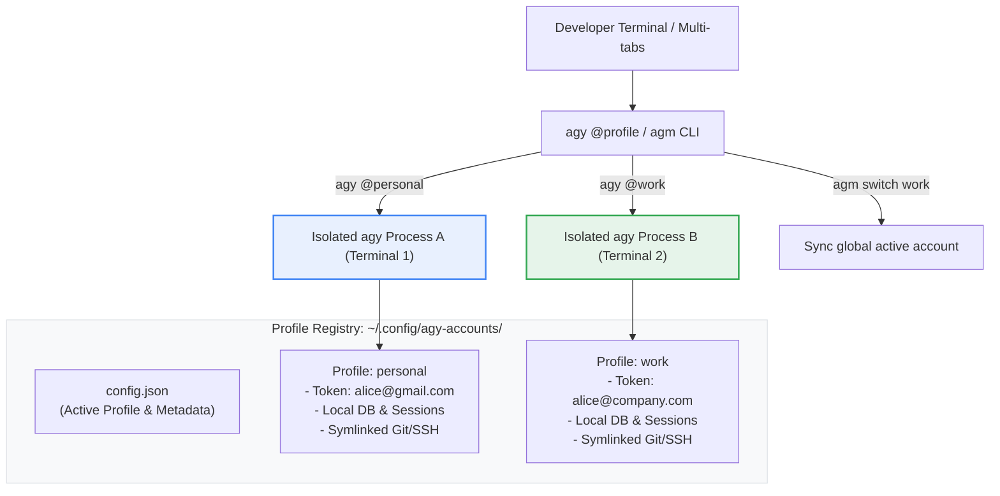

# Antigravity Multi-Account Manager (`agm`)

[](LICENSE)
[](https://www.python.org/downloads/)
[]()
[](https://antigravity.google)

**`agm`** (Antigravity Manager) is a production-grade multi-account CLI and session manager for Google Antigravity (`agy`). It enables developers to authenticate, manage, and execute **two or more Google accounts simultaneously** in parallel terminals with zero token collisions, zero database lock contention, and seamless dev environment preservation.

---

## The Problem
By default, the Google Antigravity CLI stores all state—including OAuth credentials, SQLite databases (`conversation_summaries.db`), conversation history, and model settings—under a single global directory (`~/.gemini/antigravity-cli/`).

As a result:
- **No Concurrency**: Running two accounts at once corrupts or overwrites `antigravity-oauth-token` and causes SQLite write-ahead lock contention.
- **Quota Starvation**: Hitting daily/hourly quota limits (Gemini 3.8 Flash, Pro, Claude Sonnet) halts your development workflow until quotas reset.
- **Constant Re-authentication**: Switching between work and personal Google accounts requires manual browser OAuth re-login every time.

## The Solution
`agm` introduces a lightweight **Shadow Home Architecture**:
- Each Google account receives its own isolated state directory for tokens, databases, and session logs.
- System developer tools (`~/.gitconfig`, `~/.ssh`, `~/.cargo`, `~/.config/gh`) are transparently mirrored so your Git commits, SSH keys, and workspace commands remain 100% functional.
- You can run **Account A** in Terminal 1 and **Account B** in Terminal 2 simultaneously with zero interference.

---

## Architecture Overview



---

## Quickstart in 60 Seconds

### 1. Installation
Clone the repository and run the automated installer:
```bash
git clone https://github.com/roshzxn1003/antigravity-multi-account.git ~/Projects/antigravity-multi-account
cd ~/Projects/antigravity-multi-account
./install.sh
```
*Note: Your existing authenticated Google account is automatically detected and preserved under the `default` profile.*

### 2. Add Your Second Google Account
```bash
agm add work
```
Follow the interactive prompt: a browser will open allowing you to sign in with your secondary Google account. Once authenticated, credentials are automatically captured and verified!

### 3. Run Simultaneously in Different Terminals
Open two terminal windows side by side:

- **Terminal 1** (Personal Account):
  ```bash
  agy @personal
  ```

- **Terminal 2** (Work Account):
  ```bash
  agy @work
  ```

Both sessions run in full interactive mode concurrently!

---

## Command Reference

| Command | Description |
| :--- | :--- |
| `agm list` (`agm ls`) | Render a rich Unicode table of all accounts, emails, and statuses |
| `agm add <name>` | Provision a new profile and launch Google OAuth browser login |
| `agm copy <src> <dst>` | Copy authentication credentials directly from one profile to another |
| `agm run [name] [args...]` | Run `agy` in profile environment (auto-redirects to default if unauthenticated) |
| `agm switch <name>` | Set the global default account used by bare `agy` commands |
| `agm whoami` | Show active profile and Google account email for shell/system |
| `agm doctor` | Run environment diagnostics (CLI paths, tokens, symlinks) |
| `agm pool [args...]` | Execute prompt with automatic failover across accounts |
| `agm env <name>` | Output shell export statements (`eval "$(agm env work)"`) |
| `agm remove <name>` | Safely delete a profile and its isolated state |

---

## Seamless Default Fallback & Zero Login Prompts

`agm` ensures your workflow is never interrupted by accidental OAuth popups:
- If you run `agm run` without a profile or use bare `agy`, it automatically executes under your active **default** account (`arunroshan1003@gmail.com`).
- If you target an unauthenticated profile (e.g. `agy @unconfigured`), `agm` detects the missing token and automatically redirects execution to your default account without asking for login.
- To share credentials with a new profile without logging in again: `agm copy default <new_profile>`.

---

## Shell Integration

The installer automatically adds the `@profile` syntax to `~/.bashrc`:

```bash
# Launch interactive session for work account
agy @work

# Run single prompt in print mode under work account
agy @work -p "Write unit tests for authentication"

# Normal agy still runs your active default account
agy
```

To lock an entire terminal session to a specific account permanently:
```bash
eval "$(agm env work)"
# Now all agy commands in this shell tab use 'work'
agy
```

---

## Diagnostics (`agm doctor`)

Run built-in environment diagnostics anytime to verify your setup:

```bash
agm doctor
```

Output:
```text
Antigravity System Diagnostics (agm doctor):

┌────────────────────────────────────┬─────────────┬───────────────────────────────────────────────────────┐
│ CHECK                              │ STATUS      │ DETAILS                                               │
├────────────────────────────────────┼─────────────┼───────────────────────────────────────────────────────┤
│ Antigravity CLI Binary (`agy`)     │ ✔ OK        │ Found at /usr/local/bin/agy (Executable: True)        │
│ Configuration Directory            │ ✔ OK        │ Writable at ~/.config/agy-accounts                    │
│ Antigravity State Directory        │ ✔ Found     │ ~/.gemini/antigravity-cli                             │
│ User Git Configuration             │ ✔ Found     │ ~/.gitconfig (Mirrored into shadow homes)             │
│ Shell Integration (`agy @profile`) │ ✔ Enabled   │ Bash function configured in ~/.bashrc                 │
│ Account Profiles & Credentials     │ ✔ 2/2 Ready │ 2 active accounts ready for simultaneous execution    │
└────────────────────────────────────┴─────────────┴───────────────────────────────────────────────────────┘

✔ All systems healthy! Antigravity multi-account environment is ready.
```

---

## Running Automated Tests

```bash
python3 -m unittest discover -s tests
```

Tests cover:
- JWT payload parsing & email extraction.
- Shadow home filesystem generation & symlink verification.
- Profile registration, active switching, and deletion.
- CLI argument routing and error handling.
- System diagnostics reporter.

---

## Security & Privacy
- **Local Isolation**: All tokens remain strictly stored on your local machine with `0600` (`-rw-------`) file permissions.
- **Zero Cloud Transmission**: `agm` communicates exclusively with your local `agy` binary; credentials are never sent to third-party servers.
- **Git Protection**: The `.gitignore` is configured to strictly exclude all credential files and profile state directories.

---

## License
Distributed under the [MIT License](LICENSE). Copyright (c) 2026 Arun Roshan.
