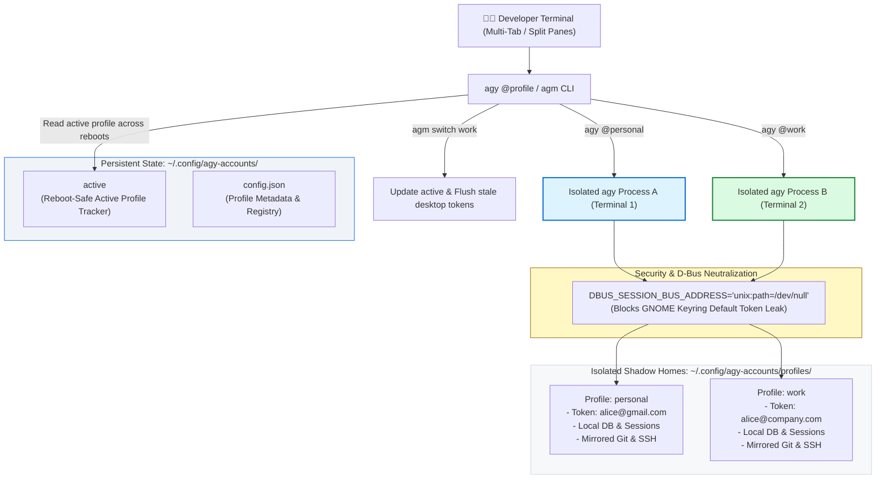

# Antigravity Multi-Account Manager (`agm`)

<div align="center">

[](LICENSE)
[](https://www.python.org/downloads/)
[]()
[](https://antigravity.google)
[]()

**Production-grade multi-account session manager and profile switcher for the Google Antigravity CLI (`agy`).**

Authenticate, manage, and execute **multiple Google accounts simultaneously** in parallel terminal tabs with zero token collisions, zero database lock contention, GNOME Keyring isolation, and persistent active profile state across computer reboots.

</div>

---

## 📑 Table of Contents

- [The Problem](#-the-problem)
- [The Solution](#-the-solution)
- [Architecture Overview](#-architecture-overview)
- [Quickstart in 60 Seconds](#-quickstart-in-60-seconds)
- [🔐 Authenticating Accounts (Step-by-Step Google OAuth Guide)](#-authenticating-accounts-step-by-step-google-oauth-guide)
- [Command Reference](#-command-reference)
- [Simultaneous Multi-Account Execution](#-simultaneous-multi-account-execution)
- [Persistent Active Profile Across Reboots](#-persistent-active-profile-across-reboots)
- [System Diagnostics (`agm doctor`)](#-system-diagnostics-agm-doctor)
- [Automated Testing](#-automated-testing)
- [Security & Isolation](#-security--isolation)
- [License](#-license)

---

## ⚠️ The Problem

By default, the Google Antigravity CLI (`agy`) stores all state—including OAuth credentials, SQLite databases (`conversation_summaries.db`), task history, and model settings—under a single global home directory (`~/.gemini/antigravity-cli/`).

Furthermore, on desktop Linux environments, `agy` queries the desktop GNOME Keyring (`service="gemini", username="antigravity"`) via the D-Bus session bus before reading local files.

This creates critical limitations for active developers:
- **Zero Concurrency**: Running two accounts simultaneously corrupts `antigravity-oauth-token` and causes SQLite write-ahead lock contention.
- **Quota Starvation**: Hitting daily or hourly model quota limits (e.g., Gemini 3.8 Flash / Pro or Claude 3.7 Sonnet) freezes your workflow until reset periods elapse.
- **Credential Leakage Across Restarts**: Desktop Secret Service / GNOME Keyring automatically reloads your default Google account token over D-Bus, ignoring secondary profiles.
- **Tedious Re-authentication**: Constant browser logins and manual credential juggling whenever switching between personal, work, or client accounts.

---

## 💡 The Solution

`agm` introduces a lightweight, zero-overhead **Shadow Home Architecture**:

- **Per-Profile State Isolation**: Each Google account receives its own isolated directory structure for tokens, databases, chat transcripts, and `~/.config/antigravity`.
- **D-Bus & Keyring Neutralization**: Subprocesses run with an isolated D-Bus session (`DBUS_SESSION_BUS_ADDRESS="unix:path=/dev/null"`), completely preventing desktop keyring tokens from bleeding into secondary accounts while safely restoring D-Bus when launching browsers.
- **Reboot-Safe Persistence**: The active profile is tracked atomically in `~/.config/agy-accounts/active`, so restarting your computer never reverts your selected profile.
- **Developer Tool Passthrough**: System tools (`~/.gitconfig`, `~/.ssh`, `~/.cargo`, `~/.config/gh`) are transparently mirrored so your Git commits, SSH keys, and workspace commands remain 100% operational.
- **Interactive Shell Integration**: Native `@profile` syntax (`agy @work`, `agy @personal`) allows instantaneous account targeting from any terminal prompt.

---

## 🏗️ Architecture Overview



---

## 🚀 Quickstart in 60 Seconds

### 1. Installation
Clone the repository and run the automated installer:
```bash
git clone https://github.com/roshzxn1003/antigravity-multi-account.git ~/Projects/antigravity-multi-account
cd ~/Projects/antigravity-multi-account
./install.sh
```
*Note: Your existing authenticated Google account is automatically detected and preserved under the `default` profile.*

### 2. Reload Shell Configuration
```bash
source ~/.bashrc   # Or: source ~/.zshrc
```

### 3. Add Your Second Google Account
```bash
agm add work
```

Follow the step-by-step browser authorization guide below to complete authentication in seconds!

---

## 🔐 Authenticating Accounts (Step-by-Step Google OAuth Guide)

When authenticating a new profile with `agm add <name>`, `agm` automatically launches the Google OAuth consent flow in an **Incognito / Private browser window** with forced account selection. This prevents Google from automatically picking your default logged-in account.

### 🌟 Recommended Method: The Fast "Copy-to-Owned-Browser" Flow

If you are **already signed in** to your secondary Google account in your regular browser (Chrome, Brave, Firefox, Edge, etc.), you **do not need to re-type your password or 2FA** inside the incognito window! Follow these simple steps:

```
┌────────────────────────────────────────────────────────────────────────────────────────┐
│  STEP 1: Run `agm add work` in your terminal.                                          │
│                                                                                        │
│  STEP 2: An Incognito browser window will automatically pop open with Google OAuth.     │
│                                                                                        │
│  STEP 3: Copy the authorization URL from the Incognito address bar (or from terminal). │
│                                                                                        │
│  STEP 4: Close the Incognito browser window.                                           │
│                                                                                        │
│  STEP 5: Paste the link into the regular browser tab where that account is logged in.  │
│                                                                                        │
│  STEP 6: Click your Google account, click Continue/Allow.                              │
│                                                                                        │
│  STEP 7: Done! The localhost callback completes and credentials save automatically.   │
└────────────────────────────────────────────────────────────────────────────────────────┘
```

#### Detailed Step-by-Step Instructions:

1. **Launch Account Provisioning**:
   ```bash
   agm add work
   ```
2. **Observe Incognito Window**:
   An Incognito/Private window opens with a URL starting with:
   `https://accounts.google.com/o/oauth2/v2/auth?...`
3. **Copy the Link**:
   Highlight the full URL in the address bar of the Incognito window and copy it (`Ctrl+C` or `Cmd+C`).  
   *(The URL is also printed directly to your terminal if you prefer copying from there).*
4. **Close the Incognito Browser**:
   Close the Incognito window. You do not need to sign in there.
5. **Paste into the Account's Browser Profile**:
   Switch to your regular browser window or browser profile where your secondary Google account (`work`) is already signed in. Paste the copied URL into the address bar and press **Enter**.
6. **Select Your Google Account**:
   Google displays the account selection screen. Click on your secondary Google account from the list.
7. **Authorize Access**:
   Review the permissions and click **Continue** / **Allow**.
8. **Automatic Completion**:
   Google redirects to `http://localhost:<PORT>/oauth2callback`. Your waiting terminal will immediately detect the authorization, extract and verify your email, store the tokens securely in that profile's isolated shadow home, and print:
   ```text
   ✔ Successfully captured OAuth credentials for 'work'!
   ✔ Verified Google Account: work-email@company.com
   ✔ Profile 'work' is ready for simultaneous execution!
   ```

---

## 💻 Command Reference

| Command | Alias | Description |
| :--- | :--- | :--- |
| `agm list` | `agm ls` | Render a rich Unicode table of all accounts, emails, active markers, and status |
| `agm add <name>` | — | Provision a new profile and launch isolated Google OAuth browser login |
| `agm run [name] [args...]` | — | Run `agy` in profile environment (defaults to active account if name omitted) |
| `agm switch <name>` | `agm use` | Set the reboot-safe active default account for bare `agy` commands |
| `agm copy <src> <dst>` | `agm cp` | Copy authentication credentials directly from one profile to another |
| `agm whoami [-s]` | — | Display active profile name and email (`-s` prints short name for scripts) |
| `agm doctor` | — | Run deep environment diagnostics (D-Bus, state file, paths, symlinks) |
| `agm pool [args...]` | — | Execute prompt with automatic quota failover across configured accounts |
| `agm env <name>` | — | Output shell export statements for locking a terminal tab (`eval "$(agm env work)"`) |
| `agm remove <name>` | `agm rm` | Safely delete a profile, its shadow home, and its isolated state |

---

## ⚡ Simultaneous Multi-Account Execution

With `agm`, you can work across multiple Google accounts in parallel terminal tabs without logging out or causing token collisions:

```bash
# Terminal Tab 1: Personal Account
agy @personal

# Terminal Tab 2: Work Account (simultaneous session)
agy @work

# Terminal Tab 3: Running a prompt in print mode under work account
agy @work -p "Review this pull request"
```

### Locking a Specific Shell Session
To lock an entire terminal tab to an account permanently:
```bash
eval "$(agm env work)"
# All subsequent bare agy commands in this tab run under 'work'
agy
```

---

## 🔄 Persistent Active Profile Across Reboots

On standard Linux setups, restarting your machine or opening new shell tabs can revert your default CLI account back to whatever token is cached in the desktop GNOME Keyring.

`agm` solves this through a two-tier persistence layer:
1. **Dedicated State File**:
   Whenever you switch accounts using `agm switch <name>`, `agm` atomically updates `~/.config/agy-accounts/active`.
2. **Reboot-Safe Shell Dispatcher**:
   The shell integration in `~/.bashrc` and `~/.zshrc` reads this active file using high-performance bash built-ins:
   ```bash
   active="$(< "$HOME/.config/agy-accounts/active")"
   ```
   Your active account selection remains intact across full system reboots, terminal restarts, and logout/login cycles.

---

## 🩺 System Diagnostics (`agm doctor`)

Run environment diagnostics anytime to verify complete system health:

```bash
agm doctor
```

Sample Output:
```text
   ___    ____  __  ___
  / _ |  / ___//  |/  /
 / __ | / (_ // /|_/ / 
/_/ |_| \___//_/  /_/  Antigravity Multi-Account Manager v1.0.0
Simultaneous sessions, zero token collisions, automatic pooling.

Antigravity System Diagnostics (agm doctor):

┌────────────────────────────────────┬─────────────┬───────────────────────────────────────────────────────────────────────────────────────┐
│ CHECK                              │ STATUS      │ DETAILS                                                                               │
├────────────────────────────────────┼─────────────┼───────────────────────────────────────────────────────────────────────────────────────┤
│ Antigravity CLI Binary (`agy`)     │ ✔ OK        │ Found at /home/user/.local/bin/agy (Executable: True)                                 │
│ Configuration Directory            │ ✔ OK        │ Writable at ~/.config/agy-accounts                                                    │
│ Antigravity State Directory        │ ✔ Found     │ ~/.gemini/antigravity-cli                                                             │
│ User Git Configuration             │ ✔ Found     │ ~/.gitconfig (Mirrored into shadow homes)                                             │
│ Shell Integration (`agy @profile`) │ ✔ Enabled   │ Bash function configured in ~/.bashrc                                                 │
│ Persistent Active Profile State    │ ✔ Synced    │ Tracks reboot-safe active profile at ~/.config/agy-accounts/active                     │
│ GNOME Keyring Isolation            │ ✔ Isolated  │ Desktop keyring blocked from leaking default token across profiles                    │
│ Account Profiles & Credentials     │ ✔ 2/2 Ready │ 2 active accounts ready for simultaneous execution                                    │
└────────────────────────────────────┴─────────────┴───────────────────────────────────────────────────────────────────────────────────────┘

✔ All systems healthy! Antigravity multi-account environment is ready.
```

---

## 🧪 Automated Testing

`agm` comes with a comprehensive test suite covering CLI dispatching, token decoding, shadow home mirroring, credential copying, keyring isolation, and diagnostic checks:

```bash
pytest
```

Output:
```text
============================== 17 passed in 0.78s ==============================
tests/test_cli.py ......                                                 [ 35%]
tests/test_core.py .........                                             [ 88%]
tests/test_doctor.py ..                                                  [100%]
```

---

## 🛡️ Security & Isolation

- **Local Machine Storage**: All tokens remain strictly stored on your local machine with `0600` (`-rw-------`) permissions.
- **Zero Cloud Transmission**: `agm` communicates exclusively with your local `agy` binary and official Google OAuth endpoints; credentials are never sent to external servers.
- **Strict `.gitignore`**: Pre-configured to prevent credential files, tokens, or shadow homes from ever being committed to Git.
- **Desktop Secret Service Neutralization**: Secondary profiles are shielded from unauthorized token leakage from GNOME Keyring and KDE Wallet via D-Bus session masking.

---

## 📄 License

Distributed under the [MIT License](LICENSE).  
Copyright (c) 2026 Arun Roshan.
